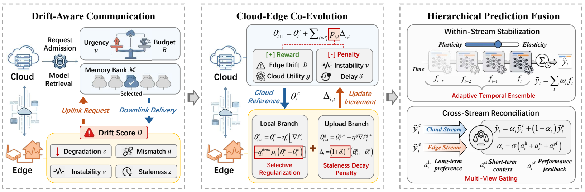

# DCE-Forecast

**Dynamic Cloud-Edge Collaboration for Non-Stationary Residential Load Forecasting**

This repository contains the open-source release of **DCE-Forecast**, a dynamic
cloud-edge collaboration framework for 24-hour-ahead residential load
forecasting in smart grids. The framework is described in:

> *Non-Stationary Residential Load Forecasting: A Dynamic Cloud-Edge Collaboration Approach*, IEEE Transactions on Smart Grid.

## What is DCE-Forecast?

Residential loads are non-stationary: households change their behavior
asynchronously, so a cloud model that is refreshed periodically quickly becomes
stale, while a purely local edge model overfits short-lived fluctuations.
DCE-Forecast treats this as a closed-loop coordination problem between one
cloud server and many edge clients (smart meters) under a limited communication
budget. It combines three coupled mechanisms:

1. **Drift-aware communication.** Each client maintains exponentially weighted
   loss statistics and combines four drift symptoms — standardized loss
   degradation, cloud-edge prediction disagreement, residual volatility, and
   synchronization age — into a single drift score. Clients whose urgency
   exceeds a threshold request synchronization, and the server activates only a
   budget-limited subset. Instead of always downloading the newest global
   model, a selected client searches the server's **memory bank** of recent
   global snapshots for the anchor that best matches its recent window
   (*selective downlink retrieval*). A downlink is accepted only when the
   retrieved anchor is empirically more useful than the client's own recent
   edge baseline.

2. **Robust cloud-edge co-evolution.** The edge learning rate increases
   smoothly with drift intensity (plasticity), while the cloud-edge tethering
   strength increases with cloud utility and decreases with drift (selective
   regularization). A separate client-side *cloud branch* transforms the
   retrieved anchor into an innovation `Δ = θ^g − θ̄^c`; the server aggregates
   reliability-calibrated, staleness-discounted innovations instead of plain
   parameter averages.

3. **Hierarchical prediction-space fusion.** Each stream (edge / cloud) is
   first stabilized by an exponentially weighted buffer of historical
   predictors whose memory scale `λ` is learned online; the stabilized streams
   are then fused by a dynamic gate `α` that combines three views: a
   long-term reliability weight (inertia), a short-term context MLP
   (responsiveness), and a recent-performance score (interpretable
   calibration).

On real-world residential data, DCE-Forecast reduces upload volume by
**66.7%–77.8%** while preserving or improving forecasting accuracy across
multiple forecasting backbones (MLP, LSTM, CNN, DLinear, PatchTST).



*DCE-Forecast system framework: drift-aware cloud-edge communication, robust
cloud-edge co-evolution, and hierarchical prediction-space fusion.*

## Repository layout

| Path            | Description |
|-----------------|-------------|
| [`simulation/`](simulation/README.md) | The core algorithm and the in-process simulation used for the paper experiments (single machine, one server + N clients). |
| [`hardware/`](hardware/README.md)     | The deployment-oriented sibling: a FastAPI cloud server and a Raspberry-Pi-ready client agent with the same co-adaptation logic, configs and systemd templates. |
| [`pi_client/`](pi_client/README.md)   | Standalone Raspberry Pi reproduction package: five-client full-flow launcher, CPU-only setup script and bundled LSTM checkpoints. |
| [`docs/HARDWARE_DEPLOYMENT.md`](docs/HARDWARE_DEPLOYMENT.md) | Parameter mapping, communication flow and step-by-step hardware deployment guide. |

## Requirements

- Python ≥ 3.10
- PyTorch ≥ 2.0 (CPU-only is fine for the quick demo)
- numpy, pandas, scikit-learn, tqdm, matplotlib

```bash
pip install -r requirements.txt
```

## Quick start (simulation)

The simulation ships with five residential clients from the BDG2 dataset
(`Lamb_*` buildings, hourly, 2016–2017) under `simulation/data/`.

```bash
cd simulation
# Warm-start by training the offline initialization on the bundled clients
# (local models + one round of federated training), then run a short online
# co-adaptation episode (72 online steps):
python main_co_adaptation.py \
    --model LSTM \
    --root-path data \
    --clients Lamb_office_Bertha Lamb_health_Ken Lamb_education_Mae \
    --train-if-missing \
    --train-epochs 3 --fed-rounds 2 --ensemble-epochs 2 \
    --max-steps 72 \
    --gpu 0

# or use the convenience script:
bash scripts/run_quick_demo.sh
```

Results are written to `results/co_adaptation/run_XXX/`:

- `run_summary.json` — overall MAE/MSE/EPE and communication totals
- `co_adaptation_metrics.csv` — per-client ensemble/local/global errors
- `communication_summary.csv` — per-client sync counts and upload/download MB
- `sync_events.csv` — per-event drift score, utility, staleness, bytes

The full 112-building dataset used in the paper is the **BDG2 dataset**
(Miller et al., *Scientific Data*, 2020, CC-BY 4.0) and is **not**
redistributed here. See [`simulation/scripts/prepare_bdg2_data.py`](simulation/scripts/prepare_bdg2_data.py)
for a script that assembles the per-building CSVs from the official BDG2
archive ([github.com/buds-lab/building-data-genome-project-2](https://github.com/buds-lab/building-data-genome-project-2),
[doi:10.5281/zenodo.3887306](https://doi.org/10.5281/zenodo.3887306)).

## Main results

Results reported in the paper (24-hour-ahead online forecasting, 18 residential
`Lamb_*` clients from BDG2, full online horizon). Each entry reports
client-averaged **MAE / MSE / EPE**.

**Main results across forecasting backbones.**

| Method | MLP | CNN | LSTM | PatchTST |
|--------|-----|-----|------|----------|
| Edge Offline | 0.7829 / 1.5463 / 0.3752 | 0.6621 / 0.9272 / 0.4119 | 0.7703 / 1.3966 / 0.4592 | 0.6934 / 1.4502 / 0.3900 |
| Edge Online | 0.4014 / 0.7854 / 0.0631 | 0.3159 / 0.5614 / 0.0207 | 0.3815 / 0.7306 / 0.0459 | 0.5168 / 0.9434 / 0.0775 |
| Cloud Offline | 0.4849 / 0.8985 / 0.1126 | 0.6623 / 0.9072 / 0.3841 | 0.7478 / 1.2931 / 0.4471 | 0.6203 / 1.2129 / 0.2771 |
| Cloud Online | 0.4172 / 0.8208 / 0.0769 | 0.3152 / 0.5858 / 0.0414 | 0.4164 / 0.7962 / 0.0742 | 0.4960 / 1.0477 / 0.0822 |
| **DCE-Forecast** | **0.3693 / 0.6875 / 0.0519** | **0.3036 / 0.5479 / 0.0193** | **0.3634 / 0.7052 / 0.0291** | **0.3929 / 0.7808 / 0.0758** |

DCE-Forecast attains the lowest MAE, MSE, and EPE for all four backbones. The
gain arises from the framework design rather than from a particular predictor:
coordinating the two streams through drift-aware communication and
prediction-space fusion outperforms either stream alone.

**Comparison with personalized and communication-efficient federated-learning
baselines (LSTM).** Sync is the average synchronization count; upload and
download are total traffic in MB.

| Family | Method | MAE | MSE | EPE | Sync | Upload (MB) | Download (MB) |
|--------|--------|-----|-----|-----|------|-------------|---------------|
| Reference | FedAvg | 0.4164 | 0.7962 | 0.0742 | 548.0 | 806.79 | 806.79 |
| Personalized FL | FedRep | 0.3763 | 0.7536 | 0.0376 | 548.0 | 804.34 | 804.34 |
| | Ditto | 0.4017 | 0.7227 | 0.0396 | 548.0 | 806.79 | 806.79 |
| Comm.-Eff. FL | DoCoFL | 0.3741 | **0.7004** | 0.0424 | 548.0 | 806.79 | 32.70 |
| | QuAFL | 0.3709 | 0.7308 | 0.0459 | **182.7** | **159.78** | 159.78 |
| Proposed | **DCE-Forecast** | **0.3634** | 0.7052 | **0.0291** | **182.7** | 268.93 | **44.90** |

QuAFL is reported under a matched-efficiency configuration with the same
average sync budget as DCE-Forecast; DoCoFL is reported under a
matched-downlink configuration. Relative to the fixed-sync FedAvg reference,
DCE-Forecast reduces the synchronization count from 548 to 182.7 and download
traffic from 806.79 MB to 44.90 MB while improving MAE from 0.4164 to 0.3634.

## Quick start (hardware server + Pi client)

```bash
# Workstation (server)
cd hardware
pip install -e .
python -m server_app.main --config deployment/server/config.server.reproduce.lstm.yaml

# Raspberry Pi (client, CPU-only PyTorch)
cd pi_client
./setup_pi_env.sh
python main.py --config configs/config.client.reproduce.lstm.yaml
```

See [`docs/HARDWARE_DEPLOYMENT.md`](docs/HARDWARE_DEPLOYMENT.md) for the full
five-client flow (FRP tunneling, systemd services, multi-Pi deployment).

## License

[MIT](LICENSE). The bundled `Lamb_*` CSV streams are derived from the BDG2
dataset (CC-BY 4.0, see above); please cite the BDG2 paper when using them.
